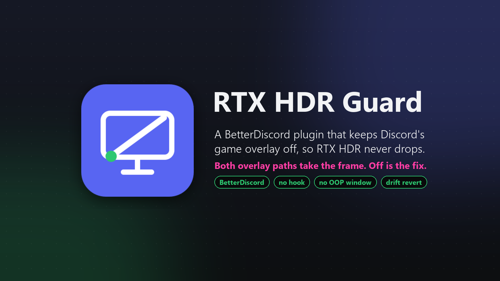

<div align="center">



[](https://github.com/SenjuWoo/rtxhdr-guard/actions/workflows/ci.yml)
[](https://github.com/SenjuWoo/rtxhdr-guard/releases/latest)
[](https://betterdiscord.app/)
[](#install)
[](RTXHDRGuard.plugin.js)
[](LICENSE)

**[Install](#install)** · **[Verify](#verify-it-worked)** · **[The problem](#the-problem)** · **[Evidence](#evidence-from-a-real-session)** · **[How it works](#how-it-works)** · **[Status](#honest-status)** · **[Changelog](CHANGELOG.md)**

</div>

RTX HDR is a driver-level SDR→HDR pass on the frame your game presents. Both of Discord's
overlay implementations take that frame away from the driver, and HDR stays off until the game
restarts. There is no overlay mode that keeps RTX HDR alive. RTX HDR Guard is one BetterDiscord
plugin file that keeps Discord's game overlay switched off, and keeps it off when Discord or its
own toggle turns it back on.

## What you get

- **No hook, no overlay window.** Both of Discord's overlay switches go to `false`: the in-process hook (`discord_hook`, which hooks `IDXGISwapChain::Present`) and the out-of-process window that composites over borderless games.
- **Takes effect without a restart.** It dispatches `OVERLAY_SET_ENABLED`, the same action Discord's own toggle fires, which persists the change and retracks running games.
- **Drift revert.** When anything turns the overlay back on, the plugin switches it off again and tells you once a minute.
- **Your settings back on disable.** Turning the plugin off restores the overlay values you had, unless you changed them yourself. The saved pair is used once, so a later disable never revives an old value.
- **A live status panel.** The gear icon shows both switches and Discord's own decision for every running game (`Hook`, `Out of Process`, `Disabled`).
- **One file, nothing else.** No Node dependencies, no companion app. Discord's internals are looked up at runtime, never by minified module id.


The shot is the real output of the two commands CI runs. The behaviour checks load the plugin file the way BetterDiscord does, against stand-ins shaped like Discord's own modules and BetterDiscord's API; a live Discord session cannot run in CI (see [status](#honest-status)).

## Install

**Manual**

1. Download [`RTXHDRGuard.plugin.js`](https://github.com/SenjuWoo/rtxhdr-guard/releases/latest/download/RTXHDRGuard.plugin.js).
2. Drop it in `%APPDATA%\BetterDiscord\plugins\`.
3. `Ctrl+R` in Discord (or restart), then enable **RTX HDR Guard** in BetterDiscord → Plugins.

**From URL**

BetterDiscord → Plugins → *Install from URL* →
`https://raw.githubusercontent.com/SenjuWoo/rtxhdr-guard/main/RTXHDRGuard.plugin.js`

Requirements: Windows, Discord desktop (stable), BetterDiscord 1.14+. Nothing else.

| You want | Do this |
|---|---|
| RTX HDR stays on | leave the plugin enabled; Discord never draws over a game |
| Discord's overlay on top of the game | disable the plugin; RTX HDR will drop again when it appears |
| Both | not possible on one display. A window that doesn't overlap the game (second monitor) is the only way |

## Verify it worked

Open BetterDiscord → Plugins → **RTX HDR Guard** → gear icon. Sample panel output:

```text
In-process hook: off · Out-of-process: off
Risk of Rain 2 [10356] — Disabled, legacy=false, oop=false
```

Green means both paths are off. `Hook` or `Out of Process` in the game line means Discord is still
drawing over that game: press **Apply now**, and restart the game if HDR is already broken.

Independent proof: `%APPDATA%\discord\logs\discord_hook.log` stops printing
`Starting graphics hook in process`, and no `Opening popout window … DISCORD_OutOfProcessOverlay`
appears while a game is focused.

### Troubleshooting

| You see | Meaning and fix |
|---|---|
| **"Overlay settings store not found"** in the panel | A Discord update moved an internal the plugin looks up. Nothing is changed in that state; the BetterDiscord console logs it under `RTXHDRGuard`. Open an issue with your Discord version. |
| HDR still off after enabling | The game kept the broken HDR state from before. RTX HDR only re-engages after a game restart. |
| A toast says the overlay was turned back on | Something (usually Discord's own overlay toggle) re-enabled it; the plugin already switched it off again. |
| Overlay still off after disabling the plugin | Your previous values were off, or you changed them while the plugin was running; the plugin only restores a pair it saved. With 1.1.0 the pair was never saved; see the [changelog](CHANGELOG.md). |

## The problem

Discord has two overlay implementations, and **both break RTX HDR**:

| Implementation | What it does to the game |
|---|---|
| in-process **Hook** (`discord_hook`) | injects into the game and hooks `IDXGISwapChain::Present` |
| **out-of-process (V3)** window | a separate always-on-top window composites over the game |

`OverlayRenderStore` picks between them per fullscreen type: exclusive `FULLSCREEN` forces the Hook
(out-of-process is only allowed for `WINDOWED` / `MAXIMIZED` / `BORDERLESS_FULLSCREEN`), borderless
gets the OOP window. Either way a Discord surface ends up over the game.

## Evidence from a real session

From `%APPDATA%\discord\logs\renderer_js.log` and `discord_hook.log` on the machine this was
written for, 2026-10-19, Risk of Rain 2 (borderless; no `discord_hook` injection was logged at all):

```text
14:50:47  [RunningGameStore] Running Games Changed  → Risk of Rain 2 tracked
14:50:50  [PopoutWindowStore] Opening popout window  → OOP overlay appears
14:51:20  [OverlayV3Store] Focused new PID 10356     → overlay on the game, RTX HDR off
14:55:10  [OverlayRenderStore] handleOverlaySetEnabled → plugin applies
14:55:10  [PopoutWindowStore] Unmounting popout window DISCORD_OutOfProcessOverlay
14:55:28  same game session (52a93325…) continues — overlay never comes back
```

The overlay was the out-of-process window, not the hook, and it still killed HDR. The plugin did
remove the overlay at 14:55:10, but the game kept the broken HDR state, because RTX HDR does not
re-engage until the game restarts.

## How it works

It removes the variable instead of chasing it:

- forces both overlay switches in Discord's local `OverlayStore6` store to `false`
  (`legacyEnabled: false`, `oopEnabled: false`): no hook, no overlay window;
- dispatches `OVERLAY_SET_ENABLED`, the action Discord's own overlay toggle fires, which persists
  the change and **retracks running games**;
- **reverts drift**: Discord's UI toggle sets both switches back to `true`, so the plugin subscribes
  to that action and re-applies itself. That was the real failure in the first test: the guard had
  applied at 02:50, something turned the overlay back on, and the plugin never noticed;
- saves your previous values with BetterDiscord's `Data` API before the first change and restores
  them when you disable the plugin, then forgets them.

Everything is looked up at runtime through BetterDiscord's webpack API, never by minified name:

| What | Lookup key |
|---|---|
| `OverlayStore6` | class with `update` + `serialize` + static `legacyEnabled` / `oopEnabled` |
| Dispatcher | exports `dispatch`, `subscribe`, `register` |
| `RunningGameStore` | `getRunningGames` + `getOverlayEnabledForGame` |
| `OverlayRenderStore` | `getGlobalEnabledStatus` + `getGameOverlayStatus` |
| `OverlayRenderUtils` | `gK` + `wR` (enum → label) |

If Discord moves any of these, the panel says **"Overlay settings store not found"** instead of
silently doing nothing, and the plugin logs it under `RTXHDRGuard` in the BetterDiscord console.

## Honest status

- **Verified against:** Discord `1.0.9262` (stable, Oct 2026). The overlay decision logic, the
  `OverlayStore6` shape, the `OVERLAY_SET_ENABLED` handler and its live retrack path were read out
  of that build's bundle. The `Data` API calls (`save` / `load` / `delete`) match BetterDiscord
  1.14.6's source.
- **Tested:** `test/plugin.test.js` runs 10 checks (33 assertions) against stand-ins built from the
  real bundle shapes and BetterDiscord's API: module discovery through nested exports, the boot-order
  race where Discord hasn't registered its handler yet, dispatch payload, idempotency, drift revert
  from inside the dispatch, Apply now, restore-on-disable, the panel, and a saved pair that is used
  only once. CI runs it on every push.
- **Not tested:** a live Discord session inside CI (it needs a running client and a game). The
  panel and `discord_hook.log` are the verification surface for that.
- **Known limit:** the overlay is off. That is the point; there is no configuration that keeps both.
  Two re-enables less than a second apart are reverted once; the second stays until the next
  toggle or **Apply now**.

## Changelog

See [CHANGELOG.md](CHANGELOG.md).

## License

MIT © [SenjuWoo](https://github.com/SenjuWoo). Not affiliated with Discord or NVIDIA.
